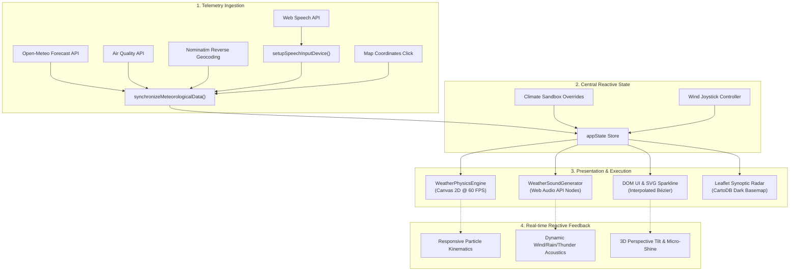
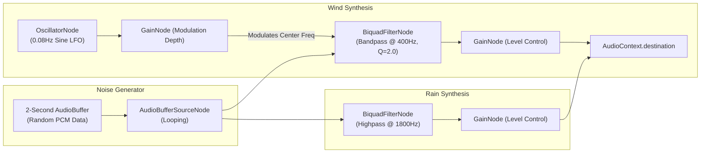

<div align="center">

# ⚡ A T M O S P H E R E
### *Next-Generation Cybernetic Meteorological Workstation & Atmospheric Physics Engine*

[](https://developer.mozilla.org/en-US/docs/Web/JavaScript)
[](https://tailwindcss.com/)
[](https://leafletjs.com/)
[](https://developer.mozilla.org/en-US/docs/Web/API/Web_Audio_API)
[](https://open-meteo.com/)
[](LICENSE)

<p align="center">
  <b>Atmosphere</b> is a glassmorphic meteorological interface combining live global atmospheric telemetry, real-time particle fluid dynamics, procedural Web Audio acoustic soundscapes, and interactive climate simulation into a zero-dependency web experience.
</p>

[Explore Architecture](#-deep-explainable-architecture) •
[Particle Physics](#-canvas-particle-physics-engine) •
[Audio Synthesis](#-procedural-web-audio-soundscape-engine) •
[Interactive Sandbox](#-climate-simulation-sandbox) •
[Quickstart](#-getting-started)

</div>

---

## 📑 Table of Contents
1. [Overview & Philosophy](#-overview--philosophy)
2. [Deep Explainable Architecture](#-deep-explainable-architecture)
   - [System Architecture Diagram](#system-architecture-flow)
   - [State Management (`appState`)](#state-management-pipeline)
3. [Canvas Particle Physics Engine](#-canvas-particle-physics-engine)
   - [Kinematics & Vector Integration](#kinematics--vector-integration)
   - [Atmospheric Particle Sub-Systems](#atmospheric-particle-sub-systems)
   - [Lightning Arc Generation Algorithm](#procedural-lightning-arc-generator)
4. [Procedural Web Audio Soundscape Engine](#-procedural-web-audio-soundscape-engine)
   - [Synthesized Weather Acoustics](#synthesized-weather-acoustics)
   - [Harmonic Star Chimes & Thunder Detonation](#harmonic-star-chimes--thunder-detonation)
   - [Synthesized Micro-Tones & UI Haptics](#synthesized-micro-tones--ui-haptics)
5. [Meteorological Data & Math Engine](#-meteorological-data--math-engine)
   - [Cubic Bézier Sparkline Generation](#cubic-bézier-sparkline-generation)
   - [WMO Weather Interpretation Pipeline](#wmo-weather-interpretation-pipeline)
   - [US-AQI Air Quality Matrix](#us-aqi-air-quality-matrix)
6. [Interactive Features](#-interactive-features)
   - [Synoptic Globe (Keyless Leaflet Integration)](#synoptic-globe-keyless-leaflet-integration)
   - [Climate Simulation Sandbox](#climate-simulation-sandbox)
   - [2D Dynamic Wind Vector Joystick](#2d-dynamic-wind-vector-joystick)
   - [Zen & Meditation Focus Mode](#zen--meditation-focus-mode)
   - [Voice Command Telemetry](#voice-command-telemetry)
7. [Repository File Structure](#-repository-file-structure)
8. [APIs & Keyless Infrastructure](#-apis--keyless-infrastructure)
9. [Getting Started](#-getting-started)
10. [Browser Support & Requirements](#-browser-support--requirements)
11. [License](#-license)

---

## 🌌 Overview & Philosophy

Most weather dashboards are static tabular views with flat icons. **Atmosphere** was engineered from first principles as an interactive atmospheric simulation terminal.

* **Zero External Build Step**: Crafted with standard modern ECMAScript, pure CSS3 variables/glassmorphism, and HTML5 Canvas. Runs instantly in any modern browser without Webpack, Vite, or npm installs.
* **100% Free & Keyless**: No API subscriptions or hidden keys required. Powered by open-access meteorological APIs and basemaps.
* **Living Canvas Physics**: Drops, flakes, clouds, and cosmic phenomena respond dynamically to wind vectors, cursor hover momentum, and day/night transitions.
* **Acoustic Feedback**: Instead of pre-recorded audio files, weather ambiances and UI sound effects are mathematically generated in real time using the browser's `AudioContext`.

---

## 🏛 Deep Explainable Architecture

### System Architecture Flow

The following diagram illustrates how telemetry data, user interactions, audio nodes, and physics loops interact:



### State Management Pipeline

At the core of Atmosphere is a single predictable state store (`appState` in `src/script.js`):

```javascript
const appState = {
    currentCoords: { lat: 48.8566, lon: 2.3522 }, // Active geographic coordinate
    currentLocationName: "Paris",                 // Human-readable location
    currentCountry: "FR",                         // ISO country code
    weatherData: null,                            // Cached Open-Meteo forecast JSON
    airQualityData: null,                         // Cached Open-Meteo pollution JSON
    selectedHourIndex: 0,                         // 0-23 scrub index for hourly timeline
    favorites: [...],                             // Persisted in localStorage
    recents: [...],                               // Persisted in localStorage
    mapInstance: null,                            // Leaflet map reference
    mapMarker: null,                              // Leaflet pulse radar marker
    bgAnimationEngine: null,                      // Active WeatherPhysicsEngine instance
    audioSynth: null,                             // Active WeatherSoundGenerator instance
    zenActive: false,                             // Zen mode presentation toggle
    windOverrideVector: { x: 0, y: 0 },           // Normalized joystick force [-1.0, 1.0]
    sandboxMode: false,                           // Manual sandbox toggle flag
    sandboxData: { temp: 20, precip: 0, type: "clear", isDay: true }
};
```

---

## 🎨 Canvas Particle Physics Engine

The visual backdrop is rendered on an HTML5 canvas via `WeatherPhysicsEngine`. It runs a continuous `requestAnimationFrame` loop that calculates frame-independent delta time:

$$\Delta t = \frac{t_{\text{current}} - t_{\text{previous}}}{1000}$$

### Kinematics & Vector Integration

Each particle's position vector $\vec{P} = (x, y)$ updates each frame according to velocity $\vec{V} = (v_x, v_y)$, terminal drag $\mu$, gravity $\vec{g}$, and global wind bias $\vec{W} = (W_x, W_y)$:

$$v_x(t + \Delta t) = (v_x(t) + W_x \cdot \text{factor}) \times (1 - \mu \cdot \Delta t)$$

$$v_y(t + \Delta t) = (v_y(t) + g) \times (1 - \mu \cdot \Delta t)$$

$$x(t + \Delta t) = x(t) + v_x \cdot \Delta t$$

$$y(t + \Delta t) = y(t) + v_y \cdot \Delta t$$

### Atmospheric Particle Sub-Systems

| Particle Sub-System | Count | Physics Model | Visual Geometry |
| :--- | :--- | :--- | :--- |
| **Rain Drops** | 220 | High vertical velocity ($800\text{–}1400\text{ px/s}$), low drag, angled by wind vector. | Translucent linear gradient streak (`#38bdf8` to `#ffffff`). |
| **Ground Splashes** | Dynamic (60 max) | Spawned when raindrops collide with canvas floor ($y \ge H$). Radial projectile dispersion. | Expanding ellipses with exponential opacity decay. |
| **Snow Crystals** | 160 | Low terminal velocity ($40\text{–}90\text{ px/s}$), sinusoidal lateral flutter: $x = x_0 + A \sin(\omega t + \phi)$. | Dual-layered blurred radial circles mimicking depth of field. |
| **Hail Impactors** | 50 | Heavy mass, rapid fall ($1100\text{ px/s}$), energetic elastic ground rebound. | Solid spherical specular dots. |
| **Turbulent Fog** | 24 | Micro-drift, high radius ($90\text{–}180\text{ px}$), soft radial gradients. | Screen blend composite clouds floating across viewport. |
| **Celestial Stars** | 120 | Static positions with individual cycle periods for twinkles: $\alpha(t) = 0.2 + 0.8 \sin^2(\omega t)$. | Sub-pixel white pinpoints with faint glow halo. |
| **Shooting Stars** | Sporadic | Exponential acceleration along diagonal vector with trailing line fade. | High-velocity linear stroke. |

### Procedural Lightning Arc Generator

During stormy conditions, lightning discharges are generated using recursive midpoint displacement:

```javascript
createLightningBolt(startX, startY, endX, endY, branchLevel = 0) {
    if (branchLevel > 2) return;
    const segments = [];
    let currentX = startX;
    let currentY = startY;
    
    while (currentY < endY) {
        const nextY = currentY + (Math.random() * 25 + 15);
        // Random lateral jitter
        const nextX = currentX + (Math.random() - 0.5) * 45;
        segments.push({ x1: currentX, y1: currentY, x2: nextX, y2: nextY });
        
        // Probabilistic secondary fractal branch
        if (Math.random() < 0.22 && branchLevel < 2) {
            this.createLightningBolt(nextX, nextY, nextX + (Math.random() - 0.5) * 120, nextY + 80, branchLevel + 1);
        }
        currentX = nextX;
        currentY = nextY;
    }
    // Triggers full-screen atmospheric specular flash and audio thunder detonation
}
```

---

## 🎵 Procedural Web Audio Soundscape Engine

Atmosphere generates its acoustic atmosphere **entirely in code** using the Web Audio API (`AudioContext`). It ships with zero audio `.mp3` or `.wav` files.

### Synthesized Weather Acoustics



* **Wind Noise**: Looping buffer fed through a bandpass filter (`Q = 2.0`) whose center frequency is modulated between $200\text{Hz}$ and $750\text{Hz}$ by a $0.08\text{Hz}$ low-frequency oscillator (LFO), creating gust variations.
* **Rain Noise**: High-passed white noise ($>1800\text{Hz}$) calibrated to mimic droplet surface impact acoustics.

### Harmonic Star Chimes & Thunder Detonation

* **Night Celestial Chimes**: An interval triggers random notes selected from the pentatonic scale ($\text{C}_5, \text{D}_5, \text{E}_5, \text{G}_5, \text{A}_5$, i.e. $523.25\text{Hz}$ to $880.00\text{Hz}$). Each chime features an instant attack and a 2.0-second exponential release envelope.
* **Procedural Thunder**: Triggered in sync with visual lightning. A sawtooth oscillator begins at $45\text{Hz}$ and sweeps down to $20\text{Hz}$ while passing through a $140\text{Hz}$ low-pass filter, shaped by a $2.5\text{s}$ exponential gain falloff.

### Synthesized Micro-Tones & UI Haptics

All tactile UI clicks, range slider adjustments, modal open/close actions, and toasts play synthetic micro-tones:
* **Card Wobble Click**: Short sine pulse ($650\text{Hz}$, $40\text{ms}$).
* **Slider Scrub**: Ultra-short tick frequency ($900\text{Hz}$, $15\text{ms}$).
* **Boot Chord**: A 4-note ascending arpeggio chord ($\text{C}_5 \rightarrow \text{E}_5 \rightarrow \text{G}_5 \rightarrow \text{C}_6$).

---

## 📊 Meteorological Data & Math Engine

### Cubic Bézier Sparkline Generation

The 24-hour temperature trend is rendered as an SVG smooth continuous curve using piecewise cubic Bézier spline interpolation:

Given anchor points $P_i(x_i, y_i)$ and $P_{i+1}(x_{i+1}, y_{i+1})$, the control points $C_{i,1}$ and $C_{i,2}$ are derived as:

$$C_{i,1} = \left( x_i + \frac{x_{i+1} - x_i}{3}, \; y_i \right)$$

$$C_{i,2} = \left( x_i + \frac{2(x_{i+1} - x_i)}{3}, \; y_{i+1} \right)$$

This ensures zero slope overshoot at local extrema and smooth transitions across diurnal cycles.

### WMO Weather Interpretation Pipeline

Atmosphere resolves World Meteorological Organization (WMO) weather code integers into SVG asset configurations, soundscape envelopes, and particle dynamics:

| WMO Codes | Semantic Condition | Visual Mode | Audio Preset |
| :--- | :--- | :--- | :--- |
| `0, 1` | Clear / Mainly Clear | Solar flares / Starry night | Ambient calm / Star chimes |
| `2, 3` | Partly Cloudy / Overcast | Drifting cloud stratum | Soft atmospheric drift |
| `45, 48` | Fog / Depositing Rime Fog | Low-visibility mist particles | Muffled low-frequency wind |
| `51–65` | Drizzle to Heavy Rainfall | Rain streaks + floor splashes | High-pass rain hiss + gusts |
| `71–77, 85–86` | Light to Heavy Snowfall | Fluttering flakes + snow drift | Soft whistle resonance |
| `95, 96, 99` | Severe Thunderstorm | Multi-strike lightning + rain | Rain + LFO wind + thunder cracks |

### US-AQI Air Quality Matrix

Real-time air telemetry is aggregated across five pollutants from the Open-Meteo Air Quality endpoint:
* **PM2.5** ($\mu\text{g/m}^3$) & **PM10** ($\mu\text{g/m}^3$)
* **NO₂** ($\mu\text{g/m}^3$)
* **SO₂** ($\mu\text{g/m}^3$)
* **Ozone ($O_3$)** ($\mu\text{g/m}^3$)

Individual values are normalized into percentage gauges with dynamic warning color thresholds (`text-emerald-400`, `text-amber-400`, `text-rose-400`).

---

## 🕹 Interactive Features

### Synoptic Globe (Keyless Leaflet Integration)
The embedded radar globe in [`src/index.html`](file:///c:/Users/Bhavesh%20Dave/OneDrive/Desktop/Atmosphere/src/index.html) initializes Leaflet using **CartoDB Dark Matter** basemap tiles. Clicking anywhere on Earth:
1. Emits a custom pulse radar pin to the exact coordinate.
2. Performs reverse-geocoding via OpenStreetMap Nominatim.
3. Automatically triggers full-station re-synchronization with Open-Meteo.

### Climate Simulation Sandbox
Switch from **Live Data** to **Sandbox Mode** to decouple the station from live APIs:
* **Temperature Slider** ($-20^\circ\text{C}$ to $+50^\circ\text{C}$)
* **Precipitation Slider** ($0\%$ to $100\%$)
* **Atmospheric Presets**: Force clear, cloudy, rainy, stormy, or snowy dynamics.
* **Cycle Force**: Instantly switch between daytime solar radiation and nighttime starry occultation.

### 2D Dynamic Wind Vector Joystick
An interactive virtual analog thumbstick allows direct physical control of atmospheric wind velocity:
* Dragging the joystick calculates normalized polar coordinates $(r, \theta)$ and maps them to Cartesian wind forces $(W_x, W_y) \in [-1.0, 1.0]$.
* The canvas particles immediately bend and accelerate in the chosen direction.

### Zen & Meditation Focus Mode
Click the **Zen Mode** button to transition into an uncluttered ambient sanctuary:
* All complex technical data panels fade away with a smooth CSS cubic-bezier transition.
* Displays a large glowing temperature readout, an inspiring atmospheric affirmation, a dynamic 24-hour clock, and generative background acoustics.

### Voice Command Telemetry
Click the **Voice Input** microphone button to activate Web Speech recognition:
* Speak any global city (e.g., *"Tokyo"*, *"London"*, *"Reykjavik"*, *"San Francisco"*).
* The voice recognizer parses the location, queries Open-Meteo's geocoding engine, and transitions the weather station automatically.

---

## 📂 Repository File Structure

```text
Atmosphere/
├── src/
│   ├── index.html       # Single Page Application structure & semantic layout
│   ├── style.css        # Glassmorphic UI styling, keyframes & animations
│   └── script.js        # Core physics engine, audio synth & reactive app logic
├── README.md            # Comprehensive architectural documentation
└── LICENSE              # Open-source MIT License
```

---

## 🌐 APIs & Keyless Infrastructure

Atmosphere relies entirely on open-access, zero-cost APIs:

| Service | Purpose | URL Pattern | Auth Required |
| :--- | :--- | :--- | :--- |
| **Open-Meteo Forecast** | Global weather forecasts, hourly/daily telemetry | `https://api.open-meteo.com/v1/forecast` | ❌ None (Free) |
| **Open-Meteo Geocoding** | City name search & autocomplete | `https://geocoding-api.open-meteo.com/v1/search` | ❌ None (Free) |
| **Open-Meteo Air Quality** | PM2.5, PM10, NO2, SO2, Ozone concentrations | `https://air-quality-api.open-meteo.com/v1/air-quality` | ❌ None (Free) |
| **OSM Nominatim** | Reverse coordinates to municipality names | `https://nominatim.openstreetmap.org/reverse` | ❌ None (Free) |
| **CartoDB Basemaps** | Leaflet dark-canvas global tile provider | `https://{s}.basemaps.cartocdn.com/dark_all/...` | ❌ None (Free) |

---

## 🚀 Getting Started

Atmosphere requires **no compilation, bundler, or build tool**.

### Option 1: Direct File Opening
Simply navigate into `src/` and double-click `index.html` in your file explorer to open it in your browser.

### Option 2: Local HTTP Server (Recommended)
For full support of Web Speech and Geolocation permissions, serve via any local web server:

```bash
# Using Python 3
python -m http.server 8000 --directory src

# Using Node.js
npx serve src

# Or using VS Code Live Server extension
# Right click src/index.html -> "Open with Live Server"
```

Open `http://localhost:8000` in your web browser.

---

## 💻 Browser Support & Requirements

| Browser | Support Level | Minimum Version | Notes |
| :--- | :---: | :---: | :--- |
| **Google Chrome / Chromium** | 100% | v80+ | Full support including Web Speech API. |
| **Microsoft Edge** | 100% | v80+ | Full support including Web Speech API. |
| **Mozilla Firefox** | 98% | v75+ | Speech recognition may require `media.webspeech.recognition.enable`. |
| **Apple Safari** | 98% | v14.1+ | Full Web Audio and Canvas support. |

---

## 📄 License

This project is open-source and released under the [MIT License](LICENSE). Feel free to use, modify, and distribute it for personal, academic, or commercial applications.

<div align="center">
  <sub>Engineered with precision for meteorological enthusiasts and creative technologists.</sub>
</div>

